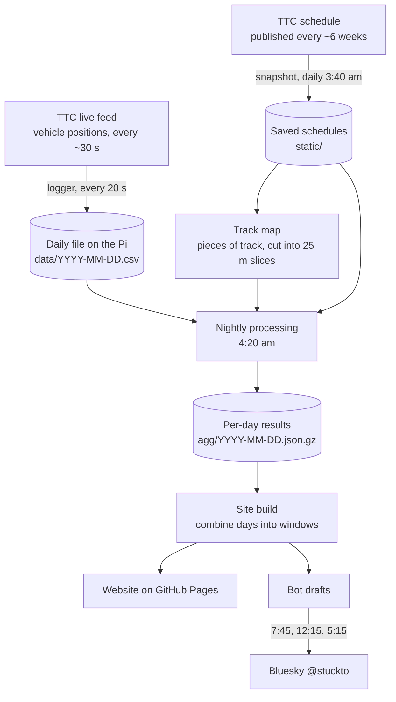

# How it works: a plain-language guide

This is the mental model of the whole system, not a code walkthrough. Read it to know roughly
where to look when something seems off, or to get someone else up to speed. Keep it current:
when a method or an assumption changes, update the matching section here in the same commit.

---

## The whole thing in one paragraph

The TTC publishes where every streetcar is, about every 30 seconds, and throws it away. A
Raspberry Pi at home records it. Each night the Pi lines up every recorded position against a
map of the track, works out how long each car took over every 25 m, and compares that with
how fast cars manage that stretch on a good run. The difference is **delay**. It also records
when cars leave each stop, to measure **waits** (how evenly cars are spaced), and how many cars
were out against the schedule. It builds the website from that and publishes it, and a bot
posts a short summary to Bluesky the next day.

---

## The journey of one position



Step by step, for one streetcar position:

1. **Logged.** The logger keeps only streetcar routes (5xx and their overnight 3xx twins), so
   buses running on streetcar routes are logged too. Their fleet number tells them apart:
   Flexity streetcars are 4400 to 4699, anything else is a bus.
2. **Snapped to the track.** The position is matched to the nearest piece of track within
   35 m that runs the same direction (the car's heading must be within 60° of the track's).
   No match means "off track" (see the track check below).
3. **Joined into a pass.** Consecutive matched positions of the same car on the same trip
   become a *pass* along a piece of track. Standing still for over 3 minutes is a layover
   and gets cut out.
4. **Turned into times.** The time between two positions is shared out over the 25 m slices
   the car covered. A pass that fully crosses a slice gives one sample: seconds spent there.
5. **Summed per day.** Each slice gets that day's samples (as a histogram and as sums by time
   of day). Nothing per car is kept beyond this; days are small and add up.
6. **Combined.** The site build adds days together into windows (yesterday, and the last 7,
   30 and 90 days) and works out the clean run and the delay for each slice. It reads one day
   at a time into running totals, so it uses the same memory however long the archive gets.

---

## What runs on the Pi, and when

| When | What | Notes |
|---|---|---|
| Always | **Logger** (`ttc-streetcars.service`) | Positions every 20 s, alerts every 2 min. A new file each service day at 4:00 am. |
| Daily ~3:40 am | **Schedule snapshot** (`ttc-gtfs-snapshot.timer`) | Saves a new TTC schedule only when one is published. |
| Hourly at :35 | **Backup** (`ttc-backup.timer`) | Copies `~/ttc-streetcars` to the SSD (`/mnt/strada/ttc-backup/current`), and once a day keeps a dated snapshot (90 days). See *Backups* below. |
| Daily 4:20 am | **Nightly build** (`ttc-delays-nightly.timer`) | Pulls the latest code from GitHub, processes yesterday, rebuilds and publishes the site, writes the bot drafts and the track check, and redraws the link-preview card (`data/card.png`). |
| 7:45 am | **Bot, morning** | Summary, then slowest spot with image (starts the day's thread). |
| 12:15 pm | **Bot, midday** | Waits at stops. |
| 5:15 pm | **Bot, evening** | Cars in service. |

The laptop only edits code. Changes go to GitHub; the Pi picks them up at the next nightly run
(or when a rebuild is started by hand).

---

## The key ideas

### Track pieces and slices
The track map is built from the shapes in every saved TTC schedule, both streetcar routes and
replacement-bus routings (because the schedule sometimes calls a stretch "bus" while
streetcars still run it). Each direction of track is a separate *piece*, cut into 25 m
*slices*. Pieces are never changed or deleted once made, so a slice means the same thing
forever; new track just adds pieces. Track no streetcar has ever used is hidden on the map.

### Clean run and delay
For each slice, the **clean run** is how fast the quickest 10% of real daytime passes got
through it, plus a normal stop at the passenger stop if there is one. It's measured from real
cars, not a theoretical speed. **Delay** is the average time minus the clean run, shown as
seconds lost per 100 m. So delay means "slower than this spot manages on a good run", which is
why slowness every car shares (a sharp curve, a slow order) is invisible here and shows in the
*clean-run speed* view instead.

### Stops, signals, everything else
Each slice is labelled using the City's traffic signal list: near a **stop**, approaching a
**signal**, **both**, or **elsewhere**. That's what the "where the time is lost" breakdown and
the transit-priority comparison use. Tunnel signals (cars pass underneath) are excluded by hand.

### Which track belongs to which route
**Observed, not scheduled** (since 2 Nov 2026). The schedule's route shapes can be wrong for
weeks: in November 2026 they had the 501 via Gerrard and the 504 via Queen West, diversions not
yet running. So every trip records the track it actually used, and a
route's line is the set of slices at least 30% of that route-direction's trips went through
in the last 3 days. A new routing shows up after about a day and an abandoned one drops off
after about two; a few cars on a short detour never count. Route filters, route cards, trip
totals and the bot all use this.

Note that **delay belongs to the track, not the route**. On track shared by two routes (King
and Queen downtown), both routes' cars feed the same slices.

### Waits (headway regularity)
Every vehicle on a route, buses included, gets a time for leaving each stop. The gap to the
next car on the same route is the *headway*. From those:
- **Average wait** for someone arriving at a random moment. Long gaps count for more, because
  you're more likely to arrive during one.
- **Excess wait**: that average minus what it would be if cars came exactly as scheduled
  (Transport for London's standard measure). Split into *uneven spacing* and *missing cars*.
- **Bunched**: a car under half the scheduled gap behind the one ahead. **Big gap**: over 1.5×.

Only frequent service counts (scheduled every 12 minutes or better). A stop where fewer than a
third of the scheduled cars showed up that day is treated as diverted and left out.

### Signals: held 90 s+
For every signal and direction, each streetcar's time through the approach (100 m before the
signal to 20 m past it) is compared with a clean approach (the quickest 10% of daytime passes).
More than 90 s longer means it most likely missed the first green it could have made: 90 s is
about a typical Toronto cycle, a stand-in, since each signal's real cycle isn't published in
usable form (shares over 60 s and 120 s are shown too). The **held 90 s+ rate** per approach, and two ranked lists
(priority that isn't delivering; no priority, held most), show *where* streetcars wait, not *why*.
Approaches with a stop in them are shown faded and left out of the rankings; a signal within
~120 m downstream is flagged, since its queue may spill back.

### Cars in service
At every feed fetch, count the distinct streetcars (and buses) signed on to each route, and
average over 10-minute steps. The schedule's vehicle assignments give the scheduled count. Cars
going to or from the yard aren't in the feed, so this is cars carrying passengers.

### The bot
After the nightly build writes yesterday's drafts, the bot posts them as one thread spread over
the day. It only posts while the switch file `~/ttc-streetcars/delays/bot-enabled` exists.
Service-change notes are drafted but not posted.

---

## Data rules

How routes, diversions and time are handled. When something new comes up, decide it against
these rather than case by case.

1. **Delay belongs to the track, not the route.** A stretch's numbers come from whatever
   streetcars actually ran over it in the chosen window. If nothing ran there, there's nothing
   to show. Diversions don't change what was measured; they change where measuring happened.
2. **Routes are a lens, worked out from observation.** A route's line is the track its cars
   actually used in the last 3 days. Diversions are never maintained by hand; the nightly
   **track check** flags anything the map can't see.
3. **Every number carries its time.** Track with no streetcars for 3 or more days is drawn
   faded, and its tooltip says when a streetcar was last there, with the route's latest TTC
   alert. Old data isn't wrong, but it's labelled as old.
4. **A long closure starts a fresh record.** If a stretch has no streetcars for 14 or more
   logged days and service then resumes, only data from after the reopening counts. Track
   that's been rebuilt is never averaged with how it was before.
5. **The window ages everything else out.** The site offers yesterday and the last 7, 30 and
   90 days (the default). There is deliberately no "all time" view: it would mix seasons,
   construction and track changes into one number. The raw archive is the long-term record,
   and anything longer-term can be rebuilt from it when it's actually wanted.

The aim is consistency, not completeness: the site shows what streetcars actually
experienced on each stretch of track, and when.

---

## Assumptions, and how you'd notice if one breaks

This is the most useful section when something looks wrong.

| The system assumes… | If it's wrong… | How you'd notice |
|---|---|---|
| Every street streetcars run on is in some saved schedule shape | Cars there match no track; that stretch has no data | **Track check** on the drafts page flags the route and place |
| The schedule's route shapes are what cars do | Route cards include track the route doesn't use | Fixed by observed patterns; a route card with odd length or totals |
| Fleet numbers 4400–4699 are streetcars | Buses counted as streetcars or vice versa | Odd "cars in service" or bus counts |
| The feed lists every car in service | Missing cars look like big gaps (waits too high) | "Cars seen" well under 100% at a stop while neighbours are fine |
| The schedule in effect is saved | No waits or scheduled counts that day | Waits view says "no headway data"; fleet post missing |
| Positions about every 30 s | Coarser timing, more smearing at stops | Very few samples; faint lines that stay faint |
| The Pi is on and online | Gaps in the archive | "Updated" date at the bottom of the panel is stale |

---

## Health checks

- **Site:** the panel's footer says when it was last updated. More than a day old means
  something stopped.
- **Drafts page** (`/drafts.html`): the **Track check** box at the top. "All streetcars stayed on
  known track" is healthy. A warning lists the route, *new* or *ongoing*, and where.
- **Waits tooltip:** "cars seen" should be roughly 85–100%. A single stop far below its
  neighbours is a detection problem, not real service.
- **Bluesky:** a thread each morning. No thread usually means no draft (nightly run failed) or
  the bot switch is off.

On the Pi (SSH), the quick looks:

```bash
systemctl list-timers --all | grep -E "ttc|bot"
journalctl -u ttc-delays-nightly.service -n 30
systemctl status ttc-streetcars.service
cat /mnt/strada/ttc-backup/last-backup.txt   # should be within the hour
```

---

## Known weak spots

- **Terminal layovers.** Waits under 3 minutes near the ends of a line can still show as delay.
- **Crowding.** The feed has a crowding field, but streetcars mostly report "empty" (their
  passenger counters may not be live). Not used.
- **A few odd stops** with low "cars seen" (e.g. King St East at Sumach on the 504) aren't
  explained yet.
- **No off-site copy.** The archive is backed up to an SSD on the same Pi (see *Backups*),
  but a fire or theft would take both. An off-site copy is still to do.
- **Early days.** Clean runs and "usual" comparisons settle after a few weeks of data. The
  bot's "usually" comparisons start after 7 days.
- **Lines 5 and 6** (Eglinton, Finch West) aren't in the TTC's live feed yet.

---

## Recipes

| To… | Do this |
|---|---|
| Pause the bot | Delete `~/ttc-streetcars/delays/bot-enabled` on the Pi (create it again to resume) |
| Apply a method change to past days | On the Pi: `cd ~/ttc-delays/pipeline && python3 nightly.py --rebuild --include-today` (~12 min) |
| Fix a stalled GitHub Pages deploy | `gh api -X POST repos/Freems88/ttc-streetcar-delays/pages/builds` |
| See what the bot would post | `python post.py morning --dry-run` on the Pi |
| Add a yard to ignore in the track check | `YARDS` in `pipeline/process_day.py` |
| Get a file back from the backup | Copy it from `/mnt/strada/ttc-backup/snapshots/<date>/…` (or `current/` for the latest) |

---

## Where things live

| Place | What |
|---|---|
| GitHub `Freems88/ttc-streetcar-delays` | All the code; the built site on the `gh-pages` branch |
| Pi `~/ttc-streetcars/data/` | The raw archive: one file per day, plus alerts |
| Pi `~/ttc-streetcars/static/` | Saved TTC schedules |
| Pi `~/ttc-streetcars/delays/` | Working files: track map (`network.json`), per-day results (`agg/`), drafts, the built site |
| Pi `~/ttc-delays/` | The Pi's copy of the code, updated each night |
| Pi `~/ttc-streetcars/bot.env` | Bot login (owner-only; never in the repo or the backup) |
| Pi `/mnt/strada/ttc-backup/` | The backup on the 1 TB SSD: `current/` plus dated `snapshots/` |

### Backups

The logger writes to the SD card; the SSD (1 TB, ext4, label `strada`, mounted at
`/mnt/strada` by UUID with `nofail`, so the Pi still boots without it) holds the backup.
`pi/ttc-backup.sh` runs hourly:

- `current/` mirrors `~/ttc-streetcars`, minus the venv, the built site and the Bluesky secrets.
- The first run after 5 am makes `snapshots/YYYY-MM-DD`. Unchanged files are hard links to the
  previous snapshot, so each costs only what changed. Kept 90 days.
- The mirror follows deletions; the snapshots are what protect against a deleted or corrupted
  file. If the SSD is missing the run fails and logging carries on regardless.

Why this way round (SD primary, SSD backup): the archive is only about 2 GB a year, so space
isn't the issue, and a USB drive that drops out would stop the logger. Revisit if the archive
grows a lot (more systems), when the SSD becoming primary starts to make sense.

---

## Glossary

- **Clean run**: how fast the best 10% of real daytime passes get through a stretch, stop included.
- **Delay**: average time minus clean run, per 100 m.
- **Excess wait**: extra waiting at a stop compared with cars arriving exactly on schedule.
- **Headway**: the time between one car and the next on the same route at the same stop.
- **Pass**: one car's continuous trip along one piece of track.
- **Pattern**: the track one route uses in one direction.
- **Piece / slice**: a one-direction stretch of track / one 25 m bit of it.
- **Service day**: 4:00 am to 4:00 am, so late-night cars count with the evening before.
- **Track check**: the nightly warning about streetcars on track the map doesn't have.

---

## Decisions worth remembering

- **Observational only:** no dollar costs, no one-off traffic counts.
- **Colour scale:** magma, breaks at 0 / 8 / 15 / 30 / 60+ s per 100 m. Recheck once there are a
  few weeks of data, then keep fixed.
- **Route patterns observed, not scheduled** (2 Nov 2026, after the schedule's diversions were
  found to be pulling routes off where cars actually ran).
- **The data rules above** (2 Nov 2026): windows of yesterday / 7 / 30 / 90 days, no all-time
  view, stale track faded, a fresh record after 14+ days closed, routes from the last 3 days.
- **Bot posts yesterday, not today,** as one thread; no service-change posts.
- **Turn-ban and transit-priority comparisons** are shown with care: placement isn't random, so
  they describe, they don't prove.
