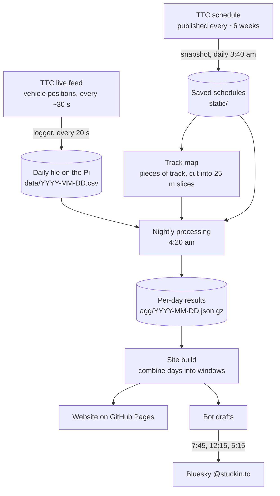

# How it works: a plain-language guide

This is the mental model of the whole system, not a code walkthrough. Read it to know roughly
where to look when something seems off, or to get someone else up to speed. Keep it current:
when a method or an assumption changes, update the matching section here in the same commit.

---

## The whole thing in one paragraph

The TTC publishes where every streetcar is, about every 30 seconds, and throws it away. A
Raspberry Pi at home records it. Each night the Pi lines up every recorded position against a
map of the track, works out how long each car took over every 25 m, and compares that with
how fast cars manage that stretch on a good run. The difference is **delay**. It also records
when cars leave each stop, to measure **waits** (how evenly cars are spaced), and how many cars
were out against the schedule. It builds the website from that and publishes it, and a bot
posts a short summary to Bluesky the next day.

---

## The journey of one position



Step by step, for one streetcar position:

1. **Logged.** The logger keeps only streetcar routes (5xx and their overnight 3xx twins), so
   buses running on streetcar routes are logged too. Their fleet number tells them apart:
   Flexity streetcars are 4400 to 4699, anything else is a bus.
2. **Snapped to the track.** The position is matched to the nearest piece of track within
   35 m that runs the same direction (the car's heading must be within 60° of the track's).
   No match means "off track" (see the track check below).
3. **Joined into a pass.** Consecutive matched positions of the same car on the same trip
   become a *pass* along a piece of track. Standing still for over 3 minutes is a layover
   and gets cut out.
4. **Turned into times.** The time between two positions is shared out over the 25 m slices
   the car covered. A pass that fully crosses a slice gives one sample: seconds spent there.
5. **Summed per day.** Each slice gets that day's samples (as a histogram and as sums by time
   of day). Nothing per car is kept beyond this; days are small and add up.
6. **Combined.** The site build adds days together into windows (yesterday, and the last 7,
   30 and 90 days) and works out the clean run and the delay for each slice. It reads one day
   at a time into running totals, so it uses the same memory however long the archive gets.

---

## What runs on the Pi, and when

| When | What | Notes |
|---|---|---|
| Always | **Logger** (`ttc-streetcars.service`) | Positions every 20 s, alerts every 2 min. A new file each service day at 4:00 am. |
| Daily ~3:40 am | **Schedule snapshot** (`ttc-gtfs-snapshot.timer`) | Saves a new TTC schedule only when one is published. |
| Hourly at :35 | **Backup** (`ttc-backup.timer`) | Copies `~/ttc-streetcars` to the SSD (`/mnt/strada/ttc-backup/current`), and once a day keeps a dated snapshot (90 days). See *Backups* below. |
| Daily 4:20 am | **Nightly build** (`ttc-delays-nightly.timer`) | Pulls the latest code from GitHub, processes yesterday, rebuilds and publishes the site, writes the bot drafts and the track check, and redraws the link-preview card (`data/card.png`). |
| 7:45 am | **Bot, morning** | Summary, then slowest spot with image (starts the day's thread). |
| 12:15 pm | **Bot, midday** | Waits at stops. |
| 5:15 pm | **Bot, evening** | Cars in service. |

The laptop only edits code. Changes go to GitHub; the Pi picks them up at the next nightly run
(or when a rebuild is started by hand).

---

## The key ideas

### Track pieces and slices
The track map is built from the shapes in every saved TTC schedule, both streetcar routes and
replacement-bus routings (because the schedule sometimes calls a stretch "bus" while
streetcars still run it). Each direction of track is a separate *piece*, cut into 25 m
*slices*. Pieces are never changed or deleted once made, so a slice means the same thing
forever; new track just adds pieces. Track no streetcar has ever used is hidden on the map.

The TTC's shapes run through every stop's pole, which stands at the curb, so the raw line bends
up to ~15 m sideways at each stop. Only the drawing straightens this (`PathGeom.straightened`,
used for the page's slices and the replay): on straight track, each point is moved onto the
line the track follows for 100 m+ either way; curves, corners and the ends of pieces are left
as they are. Matching and measuring still use the raw line, and the slices stay the same.

### Clean run and delay
For each slice, the **clean run** is how fast the quickest 10% of real daytime passes got
through it, plus a normal stop at the passenger stop if there is one. It's measured from real
cars, not a theoretical speed. **Delay** is the average time minus the clean run, shown as
seconds lost per 100 m. So delay means "slower than this spot manages on a good run", which is
why slowness every car shares (a sharp curve, a slow order) is invisible here and shows in the
*clean-run speed* view instead.

### Stops, signals, everything else
Each slice is labelled using the City's traffic signal list: near a **stop**, approaching a
**signal**, **both**, or **elsewhere**. That's what the "where the time is lost" breakdown and
the transit-priority comparison use. Tunnel signals (cars pass underneath) are excluded by hand.

### Which track belongs to which route
**Observed, not scheduled** (since 2 Nov 2026). The schedule's route shapes can be wrong for
weeks: in November 2026 they had the 501 via Gerrard and the 504 via Queen West, diversions not
yet running. So every trip records the track it actually used, and a
route's line is the set of slices at least 30% of that route-direction's trips went through
in the last 3 days. A new routing shows up after about a day and an abandoned one drops off
after about two; a few cars on a short detour never count. Route filters, route cards, trip
totals and the bot all use this.

Note that **delay belongs to the track, not the route**. On track shared by two routes (King
and Queen downtown), both routes' cars feed the same slices.

### Waits (headway regularity)
Every vehicle on a route, buses included, gets a time for leaving each stop. The gap to the
next car on the same route is the *headway*. From those:
- **Average wait** for someone arriving at a random moment. Long gaps count for more, because
  you're more likely to arrive during one.
- **Excess wait**: that average minus what it would be if cars came exactly as scheduled
  (Transport for London's standard measure). Split into *uneven spacing* and *missing cars*.
- **Bunched**: a car under half the scheduled gap behind the one ahead. **Big gap**: over 1.5×.

Only frequent service counts (scheduled every 12 minutes or better). A stop where fewer than a
third of the scheduled cars showed up that day is treated as diverted and left out, and so is
one where streetcars made under a third of that day's departures: replacement buses ran it
(the 505's Dundas stops during a weekend diversion), which isn't streetcar service. A route's
waits are shown only at stops on its own streetcar path (the patterns cars actually ran):
buses filling in among streetcars count, but a replacement-bus routing doesn't show as the
route, even where it passes another line's stop (the 506B bus up Spadina in November 2026).

### Signals: held 90 s+
For every signal and direction, each streetcar's time through the approach (100 m before the
signal to 20 m past it) is compared with a clean approach (the quickest 10% of daytime passes).
More than 90 s longer means it most likely missed the first green it could have made: 90 s is
about a typical Toronto cycle, a stand-in, since each signal's real cycle isn't published in
usable form (shares over 60 s and 120 s are shown too). The **held 90 s+ rate** per approach, and two ranked lists
(priority that isn't delivering; no priority, held most), show *where* streetcars wait, not *why*.
Each ranked signal has a "By hour" heat map: the share of each hour's streetcars in each band of
extra time, all days pooled (`signal-hours-<window>.json`, loaded only when opened). A steady
band at one wait length through the day points at signal timing rather than traffic.
Approaches with a stop in them are shown faded and left out of the rankings; a signal within
~120 m downstream is flagged, since its queue may spill back.

### Cars in service
At every feed fetch, count the distinct streetcars (and buses) signed on to each route, and
average over 10-minute steps. The schedule's vehicle assignments give the scheduled count. Cars
going to or from the yard aren't in the feed, so this is cars carrying passengers.

### Short turns
A short turn is a car sent back before the end of the line, usually to fill a gap going the
other way. Riders further along lose that car. The live feed says which scheduled trip each
car is on (it matches the schedule about 99% of the time), so for every trip we know where it
*should* have ended. A trip counts as short-turned when the car got no closer than 1 km to
that end and then, within 20 minutes, came back past a stop at least 400 m behind the furthest
one it reached, without first carrying on 500 m or more past it. (A new trip number alone
isn't enough: the feed sometimes moves a car to its next trip early, a couple of kilometres
before the end of the line, and it finishes the run anyway.) That last check came from Steve
Munro's suggestion to count cars on either side of common turn spots: the counts agreed at the
real turn spots but not at Dundas & Parliament, where every car had in fact carried on. Those
counts mislead where cars join or leave between the two lines (Coxwell, on the way to and from
Russell carhouse), which is why we check each car's path rather than counting. Diversions
aren't short turns either, though the schedule doesn't know about them: a car that goes more
than 1.5 km off its trip's path before coming back was diverted (turn-back loops seen so far
go up to about 1.2 km), and a spot where 30% or more of a direction's trips stopped short that
day was where the line ended that day. That's how the 505's weekend diversion on 7 November
2026, turning at Bathurst Station via College while buses ran Dundas, stays out of the
counts (it's counted as "diverted"). The place shown is the last scheduled stop the car reached,
not the exact turning spot, which can be a loop or a block further on. Trips the schedule itself ends early
aren't short turns. A car that just disappears is counted separately as "ended early" (taken out
of service, or lost from the feed); one heading for a yard isn't counted at all.

On the map they're yellow ⚠ marks in the Waits view (only spots with repeat turn-backs), and
each route card gives the share of trips short-turned. The replay pops a ⚠ over the car at the
moment it turns. Data starts 1 November 2026, the first day a saved schedule covers.

### Trends
A separate page (`trends.html`) charts each route day by day: time lost to delays, seconds lost
per signal (priority signals and the rest, the TSP check), excess wait, short turns and cars in
service, for all day or the AM/PM peaks. Every day is measured against **today's** baseline (the
90-day clean runs and signal approaches) and the whole series is rebuilt each night, so days
compare fairly but recent values can shift a little while the baseline settles. A dashed line
marks each new TTC schedule. Excess wait counts every vehicle (riders take whatever comes), so
a route-day run mostly by buses, like a full bus replacement, is left out of it rather than
charted as streetcar service. Toronto's daily weather (Environment Canada, station Toronto City)
runs along the top. The station only reports melted-down (liquid-equivalent) precipitation, which
the page never shows: days that stayed at or below about freezing count as snow, with depth
**estimated** from the water and the day's mean temperature (US National Weather Service
snowfall-to-meltwater table: about 10:1 near 0 °C, 15:1 to −7 °C, 20:1 colder, capped); days
above freezing are rain in mm; days that crossed freezing are "rain, possibly with some snow".
❄ marks days below −15 °C. It covers the 90-day window.

### Service changes
The schedule doesn't know about detours, so on a detour day a route's numbers describe the
detour: a "short turn" may be where the diversion turned, a stop's waits may be replacement
buses. Rather than model every detour, `servicechanges.py` reads the TTC alerts the Pi saves
and flags a route-day when a detour, no-service or route-change alert covered at least 3 of
its service hours (6 am to midnight) and the change was temporary: planned for a week or less
(a weekend diversion) or an incident. Month-long construction changes count as the route's
normal for now; the observed route patterns already follow them. Subway delays and station
elevator outages, which list connecting streetcar routes, are skipped. On flagged days the
bot doesn't name that route for its superlatives (hardest hit, most short-turned, worst stop,
furthest behind), and the trends page draws that day's point as a hollow ring, with the
alert in the tooltip.

### The bot
After the nightly build writes yesterday's drafts, the bot posts them as one thread spread over
the day. It only posts while the switch file `~/ttc-streetcars/delays/bot-enabled` exists.
Service-change notes are drafted but not posted.

The slowest-spot post names its stretch from where the time went. A stop-centred segment runs
halfway to the stops either side, so it can cross two or three lights. If one light's approach
holds 60% of the loss, it says "approaching" that light, plus whether it has transit priority.
If two or more lights hold 20% or more each, it says "between" the first and last of them, and
which one had the biggest share. Otherwise it says "at" the stop. Before, it took the first
light in the segment: on Nov 21 that put Spadina southbound "approaching Queen" (which has
priority), though the biggest share was further on, at Adelaide (which has none).

The same picks greet first-time visitors on the map page: `drafts.py` writes
`drafts/stories.json` (the newest finished day), and a plain visit (no link to a particular
view) shows them as a card until it's closed, coming back when there's a new day. Each story
opens `?story=<kind>` with the post's own view, framing the spot and pinning its tooltip.
"Yesterday's highlights" reopens the card. Time of day and direction are folded under
"More filters" unless a link sets them.

### The replay tour
`replay.html#tour=1` (or "Yesterday in 30 seconds" on the replay card, or "Watch yesterday in
30 seconds" on the map page's highlights card) plays yesterday's
picks as a short film (`site/tour.js`), about 30 s. It only runs when `stories.json` is
for the same day as `replay.json`.

Phones keep their screen on while it plays (the Screen Wake Lock API, in `replay.js`: Chrome
on Android, Safari 16.4+; other browsers ignore it). The tour holds the lock unless it's
paused. The replay plays on load and loops the day, so it holds it only for 10 minutes after
the viewer last touched the page. The browser drops the lock when the tab is hidden, and the
page asks again when it's back; a refused request waits for the next tap.
- **Opening (6 s, then 2 s held):** the whole network through the whole day. The trails fade
  back and the delay map rises out of the streets as 3D columns, one per slice, while a
  counter of hours lost climbs to the summary's figure (`stories.json` `lost_h`), with a
  count of short turns beside it (their warning signs stay off here: dozens at once is noise);
  the caption gives the total only once the counter lands.
  The close comes back to the finished columns.
- **Slower than walking** (first after the opening): someone on foot against a real
  streetcar, over a stretch where many cars that day were slower than walking. A viewer
  suggested it: a walker winning says "delay" to anyone, where minutes lost need explaining.
  It takes the slowest stretch's place in the tour (that story stays on the map's card); on a
  day with no pick, or its trip not in the replay, the slowest-stretch beat comes back.
  The pick is `walk.py`'s, written by `drafts.py` into `stories.json` as `walk`:
  - A ride is time on board: from the moment a car leaves stop A to the moment it reaches
    stop B on the same trip, not counting the wait for it (counting that, walking would win
    far more often; leaving it out keeps the claim on the safe side). The walker covers the
    track's length between the stops at a steady 4.5 km/h, a little under an ordinary pace,
    which allows for the odd wait at a crossing. Red lights aren't guessed: a walker going the
    same way mostly gets the car's greens and isn't stuck in its queue, and a walker who
    never stops is what makes the car's stops show.
  - Rides of 800 m to 1,500 m (long enough to be a real ride, short enough to frame in one
    view), daytime (06:00-22:00), not within 300 m of either end of a trip (terminal layovers:
    the 501 into Neville Park otherwise came up every day), not losing over 15 min against the
    clean run, on routes the day's service-change flags leave alone. Stops count where the
    path passes within 18 m going their way; stops within 60 m along a trip are one.
  - The stretch shown is the one with the most rides slower than walking; the ride shown
    there is the middle one by how much it lost to the walker, among those where the walker
    got 100 m or more ahead (the clean-run ghost's lesson: a lead too small to see doesn't
    work on screen). The caption's count is those rides against all rides that way.
  - First checked on Nov 3 (a Tuesday) and Nov 22 (a Sunday): 200 to 300 trips a day had an
    800 m+ stretch slower than walking, mostly the 505 on Dundas downtown. Nov 22's pick:
    the 505 westbound, Church St to University Ave, 911 m, 15:07 on board against 12:09 on
    foot, 25 of 88 rides slower. Expect it to land on Dundas often.
  - On screen: the camera holds still with both stops in frame and never zooms out past
    15.6, where the streetcar would fade to a dot (`ICON_ZOOM`, crossfading to 15.4). It
    starts from the spot beats' view (angled 60 degrees across the street, tilted 52; a
    phone starts turned to 25, the street running up its tall screen) and, while the stretch
    doesn't fit, tilts further (to 70) and then turns the street to run more up the screen,
    since tilt only shortens what runs up it. Each try is fitted as seen tilted, by setting
    the camera, projecting both stops and adjusting (cameraForBounds frames it flat). On
    Nov 22, a wide screen fits at the usual view (zoom 16.1); a 1.4 km test stretch on a
    phone needed turning to 12 degrees and tilting to 64, the far end small but still drawn.
    If nothing fits, the zoom holds anyway and the ends sit near the frame's edges.
    The clock runs straight through, no real-time hold. The walker is a sprite in the
    Flexity's flat style (mustard coat, red toque), drawn far bigger than life, on the
    sidewalk to the right of travel, with a stride while walking; labels show each one's
    time so far ("Walking · 4.5 km/h" on the walker, so the pace is on screen whatever the
    caption), the walker's freezing, ticked, at B. Captions say walking, never "race",
    which reads as running.
  - Then a quick nod to the rest of the day (the user's idea: one stretch could look like a
    one-off): the camera pulls back to the network, the streets where a trip was slower than
    walking light up in the walker's coat colour, and a tally counts the trips, with the top
    three routes. Same measure as the pick, counted by trip: a trip counts once if any of
    its rides was slower than walking, against every daytime trip with a ride measured (Nov
    22: 269 of 2,226, on 7 routes, the 505 most with 78). The lit streets are each
    stop-to-stop piece a slower ride covered, wider where more trips were slow over it.
    `walk.py` gives them as `net.lines`; `drafts.py` moves them to their own file,
    `drafts/walk-lines.json` (about 20 KB), so the map page's `stories.json` stays small.
    Without that file the step still counts. The camera fits the lit streets as seen tilted
    (home view's bearing, pitch 35), between the tally and the caption; on a phone the
    network runs across the narrow screen, so it sits small.
- **Spot beats** (the signal story, and the slowest stretch when there's no walking beat, using `at` from
  `story_of`): only the routes through the spot (the story link's `r`), every car but the
  two being shown dimmed. The camera holds still, framed between the spot and where the
  stuck car stands, from an angle: tilted 52 degrees and turned so the street runs
  diagonally up the screen with the cars heading away to the right, not looking straight up
  the road (a step further out on phones). Two real passes of the same day run side by
  side, each starting the moment it reached the spot (`state.extra` in `replay.js` draws a
  trip at a moment of its own): the stuck car (the 90th-percentile pass) and the quickest
  pass the same way over about the same distance, within an hour of it (else three hours,
  and only if it took at most 60% as long). The quick one runs a lane over so they don't
  draw on top of each other. Each car is labelled with its number, when it was there and
  its time through the spot; the quick one's label freezes, ticked, where it left. When the
  stuck car stands still 25 s or more, 2 s run in real time with a "Standing still" clock,
  then the rest is sped through. Shown one after the other, the two cars didn't read as a
  comparison; side by side they do. No clean-run baseline on screen: a car-against-ghost
  stopwatch was tried, but the clean run is a number with nothing to see behind it, and
  over a few hundred metres the ghost never got far enough ahead to show. Signal stories
  carry the approach's direction (`at.dir`): a circle round a junction also catches cars
  going the other way, and the first version showed them. Where the story has a day total (`at.cars`,
  `at.total_h`: the segment post's "adds up to" and the signal approach's
  `hours_per_day`), the clock then sweeps the whole day at the spot while a tally of cars
  and hours lost climbs and the delay map's columns rise within 450 m, on the chosen car's
  side of the street (the tally is one direction). The stop-wait story isn't in the tour:
  its number is riders' waiting time, and a car standing at a stop doesn't show that.
- **Short turns:** the route alone, its busiest four hours sped through, and a count
  climbing. The "!" markers pop up where each turn was detected (`state.pinShort`) instead of
  riding along with the car, which at tour speed sent them flying up and down the line. A
  column at every stop on the route grows with the longest gap between the route's
  streetcars there so far (a car passing within 25 m, going the stop's way; yellow at 10 min
  to red at 30; a 40-minute gap or more stands a fifth of the screen high, so the scale follows
  the camera's zoom). It only grows, so it doesn't flicker as cars pass at tour speed, and it
  ends tallest past the turn spots, where cars stopped coming. On Nov 21's 510 (7 pm to 11 pm)
  that was about 27 min along Queens Quay and at Union, against 15 to 20 on Spadina.
  The columns are the subject: the camera frames the "hot" stops (by the beat's end, a gap
  at least 60% of the way from the middle stop's to the longest, which must be 4+ min
  longer), looking from them toward the turns, so the rest of the line and its warning signs
  sit behind. With no clear hot stretch it frames the turns. The payoff caption says what
  the columns are, with `{gap}` (the longest gap) and `{typ}` (the middle stop's) taken live
  from the columns, so the words match the tally.
- **End:** the story card (the map page's first-visit card) with "Pick a car" and "Watch again".

Which car: every daytime (06:00-22:00) pass through a 150 m circle round the spot (or along
the stretch, from its first slice to its last), measured as its time minus the ghost's over
that range; the tour shows the 90th percentile, a bad but ordinary pass rather than a one-off
breakdown. Passes losing over 15 min are left out (layovers, breakdowns). Spots are ordered by
the chosen car's longest stand; a spot within 400 m of one already in is dropped (the slowest
stretch often ends at the most-held signal); at most two, with the short turns between them.
With a walking beat the order is walking, short turns, then one spot beat.

The columns (`buildPeaks`): each slice's height ends on its delay-map total for the day
(`stats-d1.json`: seconds lost per 100 m per pass x passes; summed over the network that's the
headline's hours exactly). When it grows comes from the replay: every step where a car fell
behind the ghost is put on the nearest slice within 30 m on track running the same way, in
half-hour steps; slices the replay never matched take the network's overall timing. The
weekday time-of-day slots would be site data, but weekends have only one daytime slot, too
coarse to animate. The network view scales the sixth-tallest column to 1,400 m; the sweep's
local view scales its tallest to 170 m.

The tallies' shapes over the day come from the replay (each trip's or pass's loss against the
ghost), but they're scaled to land exactly on the site's figures, since the replay's
window-based measure isn't quite the delay map's. The car-against-ghost stopwatch is the
replay's own measure for that car. Captions (`CAPTIONS` in `tour.js`) come in a few variants
per beat (plain, before/after, wry, explaining what's on screen); the day picks which, so
everyone sees the same words that day, and "Watch again" moves on a step. Rules for new
ones: ten words or so, numbers exactly as on the site (no conversions like "40 days": tried,
not obvious), never a dig at the TTC or its staff. Skip is always there; a tap (or space) pauses; Escape skips.
With reduced motion the camera jumps instead of flying.

---

## Data rules

How routes, diversions and time are handled. When something new comes up, decide it against
these rather than case by case.

1. **Delay belongs to the track, not the route.** A stretch's numbers come from whatever
   streetcars actually ran over it in the chosen window. If nothing ran there, there's nothing
   to show. Diversions don't change what was measured; they change where measuring happened.
2. **Routes are a lens, worked out from observation.** A route's line is the track its cars
   actually used in the last 3 days. Diversions are never maintained by hand; the nightly
   **track check** flags anything the map can't see.
3. **Every number carries its time.** Track with no streetcars for 3 or more days is drawn
   faded, and its tooltip says when a streetcar was last there, with the route's latest TTC
   alert. Old data isn't wrong, but it's labelled as old.
4. **A long closure starts a fresh record.** If a stretch has no streetcars for 14 or more
   logged days and service then resumes, only data from after the reopening counts. Track
   that's been rebuilt is never averaged with how it was before.
5. **The window ages everything else out.** The site offers yesterday and the last 7, 30 and
   90 days (the default). There is deliberately no "all time" view: it would mix seasons,
   construction and track changes into one number. The raw archive is the long-term record,
   and anything longer-term can be rebuilt from it when it's actually wanted.

The aim is consistency, not completeness: the site shows what streetcars actually
experienced on each stretch of track, and when.

---

## Assumptions, and how you'd notice if one breaks

This is the most useful section when something looks wrong.

| The system assumes… | If it's wrong… | How you'd notice |
|---|---|---|
| Every street streetcars run on is in some saved schedule shape | Cars there match no track; that stretch has no data | **Track check** on the drafts page flags the route and place |
| The schedule's route shapes are what cars do | Route cards include track the route doesn't use | Fixed by observed patterns; a route card with odd length or totals |
| Fleet numbers 4400–4699 are streetcars | Buses counted as streetcars or vice versa | Odd "cars in service" or bus counts |
| The feed lists every car in service | Missing cars look like big gaps (waits too high) | "Cars seen" well under 100% at a stop while neighbours are fine |
| The schedule in effect is saved | No waits or scheduled counts that day | Waits view says "no headway data"; fleet post missing |
| Positions about every 30 s | Coarser timing, more smearing at stops | Very few samples; faint lines that stay faint |
| The Pi is on and online | Gaps in the archive | "Updated" date at the bottom of the panel is stale |

---

## Health checks

- **Site:** the panel's footer says when it was last updated. More than a day old means
  something stopped.
- **Drafts page** (`/drafts.html`): the **Track check** box at the top. "All streetcars stayed on
  known track" is healthy. A warning lists the route, *new* or *ongoing*, and where.
- **Waits tooltip:** "cars seen" should be roughly 85–100%. A single stop far below its
  neighbours is a detection problem, not real service.
- **Bluesky:** a thread each morning. No thread usually means no draft (nightly run failed) or
  the bot switch is off.

On the Pi (SSH), the quick looks:

```bash
systemctl list-timers --all | grep -E "ttc|bot"
journalctl -u ttc-delays-nightly.service -n 30
systemctl status ttc-streetcars.service
cat /mnt/strada/ttc-backup/last-backup.txt   # should be within the hour
```

---

## Known weak spots

- **Terminal layovers.** Waits under 3 minutes near the ends of a line can still show as delay.
- **Crowding.** The feed has a crowding field, but streetcars mostly report "empty" (their
  passenger counters may not be live). Not used.
- **A few odd stops** with low "cars seen" (e.g. King St East at Sumach on the 504) aren't
  explained yet.
- **No off-site copy.** The archive is backed up to an SSD on the same Pi (see *Backups*),
  but a fire or theft would take both. An off-site copy is still to do.
- **Early days.** Clean runs and "usual" comparisons settle after a few weeks of data. The
  bot's "usually" comparisons start after 7 days.
- **Lines 5 and 6** (Eglinton, Finch West) aren't in the TTC's live feed yet.

---

## Recipes

| To… | Do this |
|---|---|
| Pause the bot | Delete `~/ttc-streetcars/delays/bot-enabled` on the Pi (create it again to resume) |
| Apply a method change to past days | On the Pi: `cd ~/ttc-delays/pipeline && python3 nightly.py --rebuild --include-today` (~12 min) |
| Fix a stalled GitHub Pages deploy | `gh api -X POST repos/Freems88/ttc-streetcar-delays/pages/builds` |
| See what the bot would post | `python post.py morning --dry-run` on the Pi |
| Add a yard to ignore in the track check | `YARDS` in `pipeline/process_day.py` |
| Get a file back from the backup | Copy it from `/mnt/strada/ttc-backup/snapshots/<date>/…` (or `current/` for the latest) |

---

## Where things live

| Place | What |
|---|---|
| GitHub `Freems88/ttc-streetcar-delays` | All the code; the built site on the `gh-pages` branch |
| Domain `stuckin.to` | Points at GitHub Pages (A/AAAA records on the apex, `www` CNAME); `nightly.py` writes the `CNAME` file on each publish |
| Pi `~/ttc-streetcars/data/` | The raw archive: one file per day, plus alerts |
| Pi `~/ttc-streetcars/static/` | Saved TTC schedules |
| Pi `~/ttc-streetcars/delays/` | Working files: track map (`network.json`), per-day results (`agg/`), drafts, the built site |
| Pi `~/ttc-delays/` | The Pi's copy of the code, updated each night |
| Pi `~/ttc-streetcars/bot.env` | Bot login (owner-only; never in the repo or the backup) |
| Pi `/mnt/strada/ttc-backup/` | The backup on the 1 TB SSD: `current/` plus dated `snapshots/` |

### Backups

The logger writes to the SD card; the SSD (1 TB, ext4, label `strada`, mounted at
`/mnt/strada` by UUID with `nofail`, so the Pi still boots without it) holds the backup.
`pi/ttc-backup.sh` runs hourly:

- `current/` mirrors `~/ttc-streetcars`, minus the venv, the built site and the Bluesky secrets.
- The first run after 5 am makes `snapshots/YYYY-MM-DD`. Unchanged files are hard links to the
  previous snapshot, so each costs only what changed. Kept 90 days.
- The mirror follows deletions; the snapshots are what protect against a deleted or corrupted
  file. If the SSD is missing the run fails and logging carries on regardless.

Why this way round (SD primary, SSD backup): the archive is only about 2 GB a year, so space
isn't the issue, and a USB drive that drops out would stop the logger. Revisit if the archive
grows a lot (more systems), when the SSD becoming primary starts to make sense.

---

## Glossary

- **Clean run**: how fast the best 10% of real daytime passes get through a stretch, stop included.
- **Delay**: average time minus clean run, per 100 m.
- **Excess wait**: extra waiting at a stop compared with cars arriving exactly on schedule.
- **Headway**: the time between one car and the next on the same route at the same stop.
- **Pass**: one car's continuous trip along one piece of track.
- **Pattern**: the track one route uses in one direction.
- **Piece / slice**: a one-direction stretch of track / one 25 m bit of it.
- **Service day**: 4:00 am to 4:00 am, so late-night cars count with the evening before.
- **Track check**: the nightly warning about streetcars on track the map doesn't have.

---

## Decisions worth remembering

- **Observational only:** no dollar costs, no one-off traffic counts.
- **Colour scale:** magma, breaks at 0 / 8 / 15 / 30 / 60+ s per 100 m. Recheck once there are a
  few weeks of data, then keep fixed.
- **Route patterns observed, not scheduled** (2 Nov 2026, after the schedule's diversions were
  found to be pulling routes off where cars actually ran).
- **The data rules above** (2 Nov 2026): windows of yesterday / 7 / 30 / 90 days, no all-time
  view, stale track faded, a fresh record after 14+ days closed, routes from the last 3 days.
- **Bot posts yesterday, not today,** as one thread; no service-change posts.
- **Turn-ban and transit-priority comparisons** are shown with care: placement isn't random, so
  they describe, they don't prove.
- **Stop jogs straightened for drawing only** (17 Nov 2026): fixing the pieces themselves
  would break "pieces never change"; each jog adds only ~2 m of length, which doesn't matter
  to the delay numbers. A curve-fitting version caught a few more jogs on gentle bends but
  added wobbles of its own, so it's a straight-line fit. Some jogs are left on bends and near
  piece ends.
- **Replay cars** (17 Nov 2026): glowing dots when zoomed out (below zoom 15), where a 30 m car is
  a pixel or two and drawings would pile up; zoomed in, cartoon Flexitys in TTC livery. Each car
  is five upright sprites, one per section, placed along its own track, so it bends round
  corners by itself; each section is drawn from the nearest of 24 directions to the one it faces
  on screen, and turned on screen by what's left so the sections line up along the track
  rather than stepping like stairs. The drawings are made in the browser as needed by
  projecting a box at the map's tilt (in 10-degree steps; drawn for one tilt and seen at
  another, a car's sections no longer line up) and mapping flat drawings onto its faces
  (`replay.js`, `tramSprite`). Only two tilt steps' drawings are kept at once. Drawn from photos: white bands above and
  below the windows, black bellows, blunt ends, glare on the glass, grey roof equipment,
  pantograph on the short section behind the cab, and doors on the right side only (the cars
  run one way). A halo on the ground under each car (white under the followed one) and the
  trails carry the route or speed colour, so the trails stay the legend. They're sized in
  metres, so they grow with the map and shrink with distance, but larger than life: 5x at
  zoom 15, easing to life size by zoom 18.5 (`tramScale`; any larger and cars queued at a
  stop overlap, and their tails poke into intersections); a car's ends carry on straight past
  the ends of its trip's track. Following a car flies to zoom 16.
